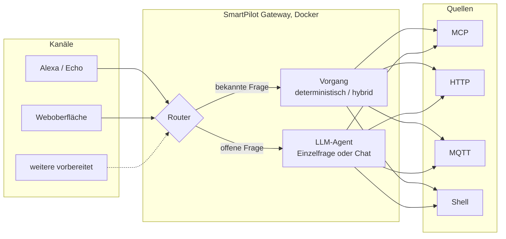

# SmartPilot

**Ein Router für Fragen: beliebige Quellen rein, Antwort per Sprache raus.**

SmartPilot nimmt eine Frage entgegen, entscheidet, woher die Antwort kommt, und
gibt sie aus — heute per **Alexa** oder in der **Weboberfläche**. Weitere
Kanäle (auch Open-Source-Speaker) sind als Adapter vorgesehen. Alles läuft
self-hosted in Docker; Quellen werden **per Parametrierung** angebunden, nicht
per Code.

Alexa ist dabei ein Kanal, keine Voraussetzung: Das Gateway ist allein
benutzbar, die erste Antwort gibt es im Browser.

## Schnellstart

Voraussetzungen: Docker mit Compose-Plugin und ein **OpenAI-kompatibler
LLM-Endpunkt mit Tool-Calling** (Base-URL, API-Key, Modellname — Cloud oder
lokal, egal).

```bash
mkdir smartpilot && cd smartpilot
curl -LO https://github.com/dezihh/SmartPilot/releases/latest/download/compose.yaml
curl -LO https://github.com/dezihh/SmartPilot/releases/latest/download/env.example
mv env.example .env
# .env ausfüllen: ADMIN_TOKEN, API_TOKEN, LLM_BASE_URL, LLM_API_KEY, LLM_MODEL
docker compose up -d
```

Läuft auf `amd64` und `arm64` (Raspberry Pi 4/5, Rock64, NAS). Im Verzeichnis
liegen danach nur `compose.yaml`, `.env` und `data/`.

1. `http://<host>:3000/admin` öffnen, Login mit `ADMIN_TOKEN`.
2. Tab **Monitor / Test**: erste Frage stellen.
3. Beim Erststart sind **Wetter (Berlin)** und **Laufzeit** schon eingerichtet —
   ohne weitere Zugangsdaten. `SEED_PROFILE=none` startet leer (wirkt nur,
   solange keine Datenbank existiert).

- **Update:** neue `compose.yaml` aus dem Release laden, `pull`, `up -d`.
- **Anpassung** (anderer Port, anderes Image): `compose.override.yaml` daneben.
- **Selbst bauen** und alle Betriebsdetails:
  [doc/INSTALLATION.md](doc/INSTALLATION.md), [doc/DOCKER.md](doc/DOCKER.md).

> Port `3000` ist im Netz offen — die Admin-UI gehört nur ins vertrauenswürdige
> Netz. Lokal einschränken mit `127.0.0.1:3000:3000` im Override. Mit
> `BASE_PATH` liegt die UI unter `/<BASE_PATH>/admin/`.

## Was es kann

| Quelle | Beispiele |
|---|---|
| **MCP** | Home Assistant, Music Assistant, Websuche, weitere MCP-Server |
| **HTTP / REST** | Wetter, Strompreis, Verkehr, Portainer, eigene Dienste |
| **MQTT** | Topics lesen, freigegebene Topics schalten (z. B. ioBroker) |
| **Shell** | Befehle in der Gateway-Umgebung |
| **LLM** | Einzelfrage oder Chat-Modus mit Gedächtnis |

Drei Antwortwege, ein Router:

- **Deterministisch** — erkannte Frage, fester Ablauf, keine KI-Lotterie.
- **Hybrid** — Daten fest aus der Quelle, das LLM formuliert nur den Satz.
- **Agent** — offene Fragen, eigene Werkzeugwahl, Rückfragen bei Mehrdeutigkeit,
  Erinnerung an vorherige Fragen („Und morgen?").

Aufbereitet wird mit Jinja-Templates (Nunjucks) — ohne Programmieren.

## Beispiel

| Frage | Was passiert |
|---|---|
| „Wie ist das Wetter?" | Open-Meteo, fester Ablauf, ohne LLM |
| „Wie lange läufst du schon?" | Laufzeit des Gateways, ohne externe Quelle |
| „Wie ist der Strompreis?" | Börsen-API, LLM formuliert den Satz |
| „Hausstatus" | Home Assistant, sofern als Paket angebunden |

## Wie es funktioniert



Der **Router** erkennt konfigurierte Vorgänge und antwortet ohne LLM
(deterministisch) oder mit reiner Formulierung (hybrid). Alles andere übernimmt
der **Agent**: ein LLM, das selbst die passenden Werkzeuge wählt. Standard ist
der OneShot-Modus (eine Frage, eine Antwort); „starte Chat-Modus" hält die
Session für Folgefragen offen.

Neue Fähigkeiten kommen als **Installationspakete** — Tab „Wartung und Pakete",
Parameter eintragen, fertig. Ein Paket legt Server, Index, Funktionen und
Vorgänge in einem Schritt an. Eigene Pakete:
[packages/README.md](packages/README.md).

## Sicherheit

- **Zwei getrennte Tokens:** `API_TOKEN` nur für `/api/*` (Alexa-Lambda),
  `ADMIN_TOKEN` nur für die Admin-UI. Sie müssen sich unterscheiden, sonst
  bricht der Start ab.
- **Öffentlich nur über einen HTTPS-Proxy:** nur `/api/query` nach außen, die
  Admin-UI nie. `TRUST_PROXY` setzen, sonst gilt das Login-Rate-Limit global.
- **Secrets nur in der `.env`**, nicht im Repo; Admin-Antworten maskieren sie.
- **Pakete sind nicht signiert:** `shell()` und stdio-Server verlangen vor dem
  Install eine Bestätigung. Nur Registry-Quellen nutzen, denen du vertraust.

Details: [doc/DEPLOYMENT.md](doc/DEPLOYMENT.md) ·
[doc/INSTALLATION.md#netzwerk-und-https](doc/INSTALLATION.md#netzwerk-und-https)

## Dokumentation

- [Installation](doc/INSTALLATION.md) — von Null bis zur ersten Antwort
- [Docker-Betrieb](doc/DOCKER.md) — Update, Rollback, Diagnose, Weg zu Alexa
- [Grundbegriffe](doc/CONCEPTS.md) · [Konfiguration](doc/CONFIGURATION.md) ·
  [Praxisrezepte](doc/RECIPES.md)
- [Alexa anbinden](doc/ALEXA.md) — Skill, Lambda, Härtung (optional)
- [Referenz](doc/REFERENCE.md) · [Fehlersuche](doc/TROUBLESHOOTING.md) ·
  [Architektur](doc/ARCHITECTURE.md)
- [Paket-Registry](packages/README.md) · [Beitragen](CONTRIBUTING.md) ·
  [Changelog](CHANGELOG.md)

## Status

Junge Software, aktiv gepflegt. Gateway, Testmonitor und Pakete sind getestet;
die Alexa-Anbindung läuft produktiv mit eigener AWS-Lambda. Fehler sind trotzdem
möglich — nutze SmartPilot nicht ohne Blick darauf, was es im Smart Home anfasst,
und melde Auffälligkeiten über
[Issues](https://github.com/dezihh/SmartPilot/issues).

Vor Updates `data/` sichern (die Datenbank wird migriert) und die Konfiguration
über „Sicherung herunterladen" exportieren. Lizenz: [AGPL-3.0](LICENSE).
