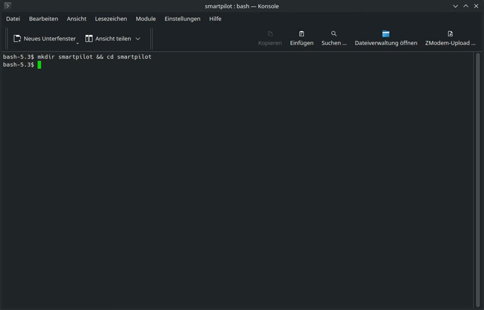

# Demos

Kurze Videos zu den wichtigsten Abläufen. Die Standbilder verlinken auf das
jeweilige Video.

## Installation

Docker-Compose, `.env`, erster Start und Login. Länge: 1:03.

## Pakete

Folgt.

## Alexa

Folgt.
